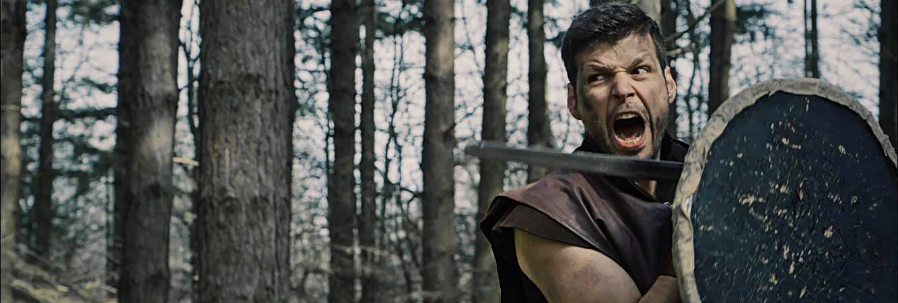

# Hi, I'm Yordan 👋

**Full-stack JavaScript developer · React & React Native · Professional actor**

I'm based in Plovdiv, Bulgaria, and build web and mobile applications with JavaScript and TypeScript. My work spans interfaces, APIs, and databases.

[Portfolio](https://yordankrushkov.vercel.app/) · [LinkedIn](https://www.linkedin.com/in/yordankrushkov) · [Email](mailto:yordankrushkov@gmail.com)

## What I work with

| Area | Technologies |
| --- | --- |
| Web | React, Next.js, TypeScript, JavaScript |
| Mobile | React Native |
| Backend & data | Node.js, Express, PostgreSQL, MongoDB, GraphQL |
| UI | HTML, CSS, Sass, Tailwind CSS |
| Testing & tools | Jest, Cypress, Git, Docker |

## Explore my work

- **[Portfolio](https://yordankrushkov.vercel.app/)** — my personal website. [Browse the React source](https://github.com/YordanKrushkov/porfolio).
- **[Online Store](https://github.com/YordanKrushkov/online_store)** — an Angular project.
- **[Jiu-jitsu](https://github.com/YordanKrushkov/jiu-jitsu)** — a React project that connects development with my interest in sports.

## Beyond the code

I'm also a professional actor, with interests in movies, stage combat, and sports. Creativity is a big part of my life, on stage and at the keyboard.

A glimpse of my acting work

 

## Let's connect

Have a project or collaboration in mind? Reach me on [LinkedIn](https://www.linkedin.com/in/yordankrushkov) or [send me an email](mailto:yordankrushkov@gmail.com).
